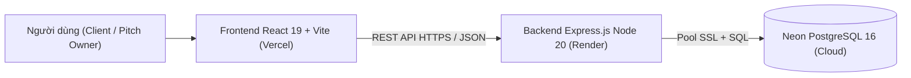

# Soccer Booker — dat_san_bong_173820_n04

> Hệ thống đặt sân bóng đá trực tuyến (giữ chỗ 4 giờ qua chuyển khoản ngân hàng & quản lý cụm sân) dành cho người chơi phong trào và chủ sân tại Hà Nội.

## 1. Giới thiệu sản phẩm
- **Bài toán / người dùng đích:** Giải quyết tình trạng trùng lịch sân giờ vàng, thiếu minh bạch khung giờ trống và thất lạc xác nhận đặt cọc khi đặt sân thủ công qua tin nhắn/điện thoại cho 2 nhóm người dùng: **Khách đặt sân (`CLIENT`)** và **Chủ sân (`PITCH_OWNER`)**.
- **Case study:** Đề tài nhóm đề xuất (`dat_san_bong`) — Lớp `173820`, Nhóm `N04`.
- **Tính năng chính của MVP (Nhánh 1, 2, 4):**
  1. Đăng ký, đăng nhập JWT & phân quyền RBAC (`CLIENT` / `PITCH_OWNER`), quản lý hồ sơ và đổi mật khẩu.
  2. Tra cứu 10 cụm sân Hà Nội (15 sân con 5v5/7v7/11v11) theo tên không dấu, quận/huyện và bản đồ GPS OpenStreetMap.
  3. Đặt sân theo 6 khung giờ chuẩn (`06:00–22:00`), chặn trùng lịch tuyệt đối bằng `PostgreSQL btree_gist` / partial unique index, giữ chỗ 4 giờ với đồng hồ đếm ngược, báo chuyển khoản cọc kèm thông tin ngân hàng chủ sân.
  4. Cổng Chủ sân (`PITCH_OWNER`): duyệt/từ chối cọc, chốt hóa đơn hoàn tất, quản lý cấu hình giá 7 ngày × 6 ca, khóa slot bảo trì, thống kê doanh thu và Audit Log.
  5. Đánh giá sau trận và hỏi đáp bình luận công khai trên trang từng sân.

## 2. Phạm vi MVP
| Trạng thái | Nội dung |
|---|---|
| ✅ Đã làm | Nhánh 1 (Auth/Profile/Đổi mật khẩu), Nhánh 2 (Tìm sân Hà Nội, Bản đồ GPS, Đặt sân giữ chỗ 4h, Báo cọc chuyển khoản, Đánh giá & Hỏi đáp, Hủy/Lịch sử), Nhánh 4 (Cụm sân, Sân con, Giá tuần 6 ca, Khóa slot, Duyệt đơn & Chốt hóa đơn, Doanh thu, Audit Log), tối ưu bundle + Neon indexes + cấu hình deploy Architecture A (Vercel + Render + Neon) |
| 🚧 Đang làm | Mở rộng integration test đạt độ phủ ≥ 60% và quay video demo chính thức cho Tuần 12–14 |
| ⬜ Chưa làm | Đánh giá chi tiết bảo mật/hiệu năng tải cao (Tuần 13), Review chéo nhóm bạn (Tuần 14), Slide bản cuối (Tuần 15) |
| 🚫 Ngoài phạm vi | Nhánh 3 (Quản lý giải đấu, BXH, Ghép kèo đối thủ) tạm ẩn route trong bản MVP để tập trung chất lượng luồng cốt lõi |

## 3. Kiến trúc & công nghệ


- **Ngôn ngữ / Framework:**
  - Frontend: React 19, TypeScript, Vite 8 (`React.lazy` code-splitting), Tailwind CSS v4, Leaflet (OpenStreetMap), Vitest 4.
  - Backend: Node.js ≥ 20, Express 4, Zod, `pg` Pool, JWT (`jsonwebtoken`), `bcryptjs`, `compression`, Vitest 2 + Supertest.
  - Database: PostgreSQL (Neon Cloud) với migration `V1` (Schema + Partial Unique Index chống trùng slot), `V2` (Tài khoản & Ca chuẩn), `V3` (10 cụm sân Hà Nội), `V4` (Performance Indexes).
- **Cấu trúc thư mục `src/`:**
  - `src/frontend/` — mã nguồn giao diện React/Vite + cấu hình `vercel.json`
  - `src/demo_backend/` — mã nguồn REST API Express + job tự động hủy giữ chỗ quá hạn 4 giờ
  - `src/database/` — script SQL DDL/Seed/Index (`V1`–`V4`) và tài liệu triển khai

## 4. Cài đặt & cách sử dụng
**Yêu cầu môi trường:** Node.js >= 20, PostgreSQL 15+ (local hoặc Neon Cloud miễn phí), Python 3.11 (chạy validator).

### Chạy cục bộ trong ≤ 15 phút
```bash
# Bước 1: Tạo database PostgreSQL và nạp schema + dữ liệu mẫu synthetic (V1 -> V4)
psql "$DATABASE_URL" -f src/database/V1__soccer_booker_demo_schema.sql
psql "$DATABASE_URL" -f src/database/V2__seed_demo_data.sql
psql "$DATABASE_URL" -f src/database/V3__seed_hanoi_pitches_crawled.sql
psql "$DATABASE_URL" -f src/database/V4__perf_indexes.sql

# Bước 2: Cài đặt và chạy Backend (cổng 8080)
cd src/demo_backend
cp .env.example .env   # Điền DATABASE_URL và JWT_SECRET (KHÔNG commit .env)
npm install
npm start

# Bước 3: Mở terminal mới, cài đặt và chạy Frontend (cổng 5173, proxy /api -> 8080)
cd src/frontend
cp .env.example .env
npm install
npm run dev            # Truy cập http://localhost:5173
```

### Lệnh chạy kiểm thử tự động
```bash
cd src/demo_backend && npm test   # Backend acceptance tests (4/4 pass)
cd src/frontend && npm test       # Frontend unit/component tests (17 files, 176/176 pass)
```

### Triển khai cố định 24/7 (Kiến trúc A: Vercel + Render + Neon)
- File `render.yaml` cấu hình sẵn dịch vụ `demo_backend` (rootDir: `demo_backend`, healthCheck: `/api/v1/health`).
- File `src/frontend/vercel.json` cấu hình rewrite SPA `/(.*) -> /index.html` và cache tĩnh.

**Dữ liệu / tài khoản mẫu (100% synthetic):**
- **Chủ sân (`PITCH_OWNER` + `CLIENT`):** `owner@soccerbooker.vn` / `Demo@123`
- **Khách hàng (`CLIENT`):** `client@soccerbooker.vn` / `Demo@123`

**Kịch bản sử dụng (≥ 3 kịch bản):**
1. *Kịch bản 1 — Tìm sân & Kiểm tra lịch trống:* Mở `/booking` → gõ từ khóa không dấu (vd `"bach khoa"`, `"my dinh"`) hoặc chọn quận/bản đồ GPS → chọn ngày đá → hệ thống hiển thị giá & trạng thái 6 ca từ PostgreSQL.
2. *Kịch bản 2 — Đặt sân giữ chỗ 4 giờ & Báo chuyển khoản cọc:* Đăng nhập `client@soccerbooker.vn` → chọn 1 ca trống → xác nhận giữ chỗ → hệ thống chuyển sang `/checkout` hiển thị đồng hồ đếm ngược 4 giờ & STK chủ sân → nhập số tiền đã CK → bấm *Xác nhận đã chuyển khoản cọc* (`WAITING_FOR_DEPOSIT`).
3. *Kịch bản 3 — Chủ sân duyệt cọc, chốt hóa đơn & thống kê:* Đăng nhập `owner@soccerbooker.vn` tại `/admin/orders` → thấy đơn mới & số tiền khách báo CK → bấm *Xác nhận đơn* (`CONFIRMED`, ghi sổ `financial_entries` & `audit_logs`) → bấm *Chốt hoá đơn* (`COMPLETED`) → kiểm tra doanh thu cập nhật trên `/admin`.

## 5. Hướng phát triển Tuần 11–15
| Tuần | Mục tiêu | Đầu việc chính | Phụ trách (MSSV) | Tiêu chí hoàn thành | Trạng thái |
|:---:|---|---|---|---|:---:|
| 11 | Chốt MVP & CI | Đóng băng phạm vi Nhánh 1,2,4; tối ưu FE/BE; hoàn thiện README 6 mục & cấu hình Architecture A | `202414021`, `20233605`, `202414018` | MVP chạy được theo README; `validate_submission.py` pass | ✅ |
| 12 | Kiểm thử & tích hợp | Bổ sung integration test BE/FE ≥ 60%, viết `Test_Report_v1`, test cài đặt trên máy sạch ≤ 15 phút | `202414018`, `202414021` | 1 lệnh test pass toàn bộ; có `report/Test_Report_v1.md` | ⬜ |
| 13 | Bảo mật, hiệu năng & AI | Kiểm tra RBAC/IDOR/SQLi, benchmark API latency trên Neon, tổng hợp báo cáo bảo mật & AI | `202414021`, `20233605` | Không còn lỗi bảo mật mức cao; có số liệu đo latency | ⬜ |
| 14 | Review chéo & code freeze | Peer review 1 nhóm khác, sửa góp ý, quay video demo 3–5 phút, đóng băng code | `20233605`, `202414018` | Hoàn thành comment review + video demo + code freeze | ⬜ |
| 15 | Nghiệm thu & bảo vệ | Hoàn thiện báo cáo kỹ thuật cuối kỳ, slide thuyết trình (≤ 10MB), gắn tag `v1.0` | `202414021`, `20233605`, `202414018` | PR cuối xanh + demo trực tiếp trên Architecture A | ⬜ |

## 6. Nhóm & tuân thủ
- **Mã nhóm:** `173820_n04`
- **Thành viên (chỉ dùng MSSV theo quy định bảo mật repo công khai):**
  - `202414021` — Nhóm trưởng, Kiến trúc Backend & PostgreSQL Database
  - `20233605` — Frontend React/Vite, Bản đồ GPS & Tối ưu giao diện
  - `202414018` — Phân tích nghiệp vụ (BA), Tài liệu đặc tả & Kiểm thử SQA
- **✅ Zero PII/PHI:** Toàn bộ người dùng, số điện thoại, tài khoản ngân hàng, sân bóng và giao dịch mẫu trong repo là dữ liệu synthetic/mô phỏng phục vụ học tập. Không commit `.env`, `DATABASE_URL` thật hay khóa bí mật.
- **Công cụ AI đã dùng & phạm vi:** Sử dụng trợ lý AI hỗ trợ chuẩn hóa migration SQL (`V1`–`V4`), rà soát tối ưu hiệu năng truy vấn/bundle, viết skeleton test tự động và kiểm tra chéo tài liệu kỹ thuật; mọi logic nghiệp vụ và kết quả test đều được nhóm tự chạy kiểm chứng.
- **Dữ liệu lớn (>10MB):** Không phát sinh file > 10MB trong gói nộp mã nguồn.
